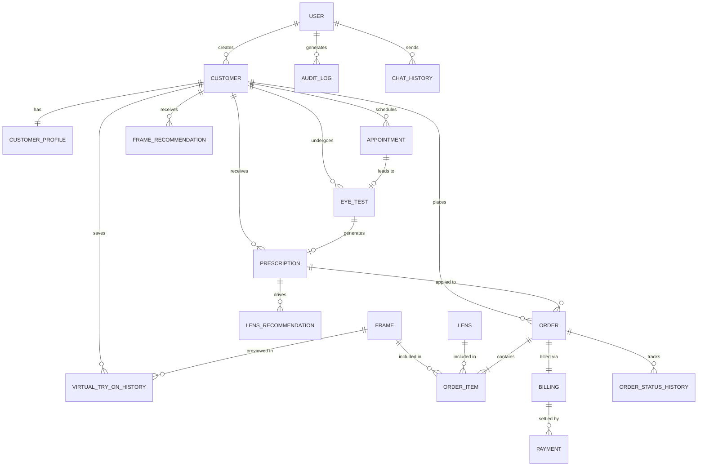

# Database Design Specification Document
### *for*
# VisionEdge: AI-Powered Optical Store Management & Virtual Try-On System

**Version:** 1.0  
**Database Engine:** MySQL 8.0 / MariaDB (Compatible with SQLite 3)  
**ORM Framework:** SQLAlchemy 2.0 (Flask-SQLAlchemy)  
**Date:** August 2026  

---

## Table of Contents

- [1. Executive Summary & Architectural Overview](#1-executive-summary--architectural-overview)
- [2. Entity-Relationship (ER) Visual Model](#2-entity-relationship-er-visual-model)
- [3. Database Conceptual & Logical Modules](#3-database-conceptual--logical-modules)
  - [3.1 Module 1: User Authentication & Administration](#31-module-1-user-authentication--administration)
  - [3.2 Module 2: Customer CRM & Clinical Eye Examinations](#32-module-2-customer-crm--clinical-eye-examinations)
  - [3.3 Module 3: Frames & Optical Lens Inventory](#33-module-3-frames--optical-lens-inventory)
  - [3.4 Module 4: Sales Orders, Invoicing & Payment Processing](#34-module-4-sales-orders-invoicing--payment-processing)
  - [3.5 Module 5: AI Vision, Recommendations & Virtual Try-On](#35-module-5-ai-vision-recommendations--virtual-try-on)
- [4. Complete Data Dictionary (23 Tables)](#4-complete-data-dictionary-23-tables)
- [5. Normalization & Relational Integrity Analysis](#5-normalization--relational-integrity-analysis)
- [6. Indexing Strategy & Query Performance Optimization](#6-indexing-strategy--query-performance-optimization)
- [7. Foreign Key Cascade & Data Security Policies](#7-foreign-key-cascade--data-security-policies)

---

## 1. Executive Summary & Architectural Overview

The **VisionEdge** database architecture provides a robust relational data store supporting clinical optometry workflows, artificial intelligence vision scanning, interactive Virtual Try-On (VTO), inventory management, order processing, and GST-compliant invoicing. 

The schema is built on **MySQL 8.0** / **MariaDB** using the `InnoDB` storage engine for ACID transactional compliance and foreign key enforcement, while maintaining multi-database compatibility with **SQLite 3** via Python's **Flask-SQLAlchemy** ORM.

### Key Architectural Characteristics:
* **Storage Engine**: `InnoDB` with `utf8mb4` character encoding (full Unicode support).
* **Primary Key Strategy**: Auto-incrementing 32-bit Integers for high-performance join operations, supplemented by unique alphanumeric business keys (`customer_code`, `prescription_number`, `order_id`, `invoice_number`).
* **Transactional Guarantee**: ACID compliance with automated rollback on failed order/billing transactions.
* **Integrity Enforcement**: Explicit Foreign Key constraints utilizing `ON DELETE CASCADE` for parent-child dependencies (e.g., `customer` -> `customer_profile`) and `ON DELETE SET NULL` for historical audit references.

---

## 2. Entity-Relationship (ER) Visual Model

The diagram below illustrates the core entities and their relationships within the VisionEdge ecosystem:

---

## 3. Database Conceptual & Logical Modules

The schema is divided into 5 logical domain modules:

### 3.1 Module 1: User Authentication & Administration
Handles system login accounts, role-based security assignments (`admin`, `staff`, `customer`), system notifications, AI assistant logs, and security audit trails.
* **Tables**: `user`, `audit_log`, `notification`, `chat_history`.

### 3.2 Module 2: Customer CRM & Clinical Eye Examinations
Manages customer demographics, clinical medical notes (eye conditions, blood group, allergies), appointment schedules, OD/OS clinical eye tests, and AI Gemini OCR scanned prescriptions.
* **Tables**: `customer`, `customer_profile`, `appointment`, `eye_test`, `prescription`.

### 3.3 Module 3: Frames & Optical Lens Inventory
Controls spectacle frame attributes (shape, brand, material, size, price, stock, transparent VTO PNG URL), lens specifications (design type, refractive coating, price, stock), supplier contacts, and inventory stock adjustment ledgers.
* **Tables**: `frame`, `lens`, `supplier`, `brand`, `category`, `inventory_transaction`.

### 3.4 Module 4: Sales Orders, Invoicing & Payment Processing
Manages retail sales orders, itemized order lines (frames + lenses), GST tax calculations, payment modes (Cash, Card, UPI), billing receipts, and order fulfillment states.
* **Tables**: `order`, `order_item`, `billing`, `payment`, `order_status_history`.

### 3.5 Module 5: AI Vision, Recommendations & Virtual Try-On
Stores algorithmic recommendations matching frame geometry to face shapes, clinical prescription lens recommendations, and saved customer Virtual Try-On snapshot images.
* **Tables**: `frame_recommendation`, `lens_recommendation`, `virtual_try_on_history`.

---

## 4. Complete Data Dictionary (23 Tables)

### 4.1. Table: `user`
Manages system authentication credentials, user profiles, and authorization roles.

| Column Name | Data Type | Constraints | Default Value | Description |
| :--- | :--- | :--- | :--- | :--- |
| `id` | `INT` | PRIMARY KEY, AUTO_INCREMENT | *None* | Unique user ID |
| `username` | `VARCHAR(80)` | NOT NULL, UNIQUE | *None* | Account login handle |
| `first_name` | `VARCHAR(50)` | NULLABLE | `NULL` | Given first name |
| `last_name` | `VARCHAR(50)` | NULLABLE | `NULL` | User surname |
| `password_hash` | `VARCHAR(255)` | NOT NULL | *None* | Bcrypt/PBKDF2 secure hashed password |
| `email` | `VARCHAR(120)` | UNIQUE, NULLABLE | `NULL` | Contact email address |
| `phone` | `VARCHAR(20)` | NULLABLE | `NULL` | Phone number |
| `gender` | `VARCHAR(20)` | NULLABLE | `NULL` | Gender identification |
| `date_of_birth` | `DATE` | NULLABLE | `NULL` | Date of birth |
| `address` | `TEXT` | NULLABLE | `NULL` | Street address |
| `role` | `VARCHAR(50)` | NOT NULL | `'customer'` | Security role (`admin`, `staff`, `customer`) |
| `created_at` | `DATETIME` | NOT NULL | `CURRENT_TIMESTAMP` | Account creation timestamp |

---

### 4.2. Table: `customer`
Stores demographic data and contact information for store clients.

| Column Name | Data Type | Constraints | Default Value | Description |
| :--- | :--- | :--- | :--- | :--- |
| `id` | `INT` | PRIMARY KEY, AUTO_INCREMENT | *None* | Unique customer ID |
| `customer_code` | `VARCHAR(20)` | UNIQUE | `NULL` | Alphanumeric business code (e.g. `CUST-101`) |
| `first_name` | `VARCHAR(50)` | NOT NULL | *None* | Customer first name |
| `last_name` | `VARCHAR(50)` | NOT NULL | *None* | Customer last name |
| `gender` | `VARCHAR(20)` | NULLABLE | `NULL` | Customer gender |
| `date_of_birth` | `DATE` | NULLABLE | `NULL` | Birthdate |
| `age` | `INT` | NULLABLE | `NULL` | Calculated age in years |
| `phone` | `VARCHAR(20)` | NOT NULL, INDEXED | *None* | Primary telephone number |
| `alternate_phone`| `VARCHAR(20)` | NULLABLE | `NULL` | Secondary phone number |
| `email` | `VARCHAR(120)` | INDEXED, NULLABLE | `NULL` | Email address |
| `address` | `TEXT` | NULLABLE | `NULL` | Residential address |
| `city` | `VARCHAR(100)` | NULLABLE | `NULL` | Resident city |
| `state` | `VARCHAR(100)` | NULLABLE | `NULL` | Resident state |
| `pincode` | `VARCHAR(20)` | NULLABLE | `NULL` | Postal pincode |
| `occupation` | `VARCHAR(100)` | NULLABLE | `NULL` | Profession/Occupation |
| `photo` | `VARCHAR(255)` | NULLABLE | `NULL` | Path to customer profile image |
| `status` | `VARCHAR(20)` | NOT NULL | `'Active'` | Customer status (`Active`, `Inactive`) |
| `created_at` | `DATETIME` | NOT NULL | `CURRENT_TIMESTAMP` | Profile creation timestamp |
| `updated_at` | `DATETIME` | NOT NULL | `CURRENT_TIMESTAMP` | Last update timestamp |
| `created_by` | `INT` | FOREIGN KEY (`user.id`) | `NULL` | Staff user who registered customer |

---

### 4.3. Table: `customer_profile`
Stores extended medical notes and clinical parameters (1-to-1 extension of `customer`).

| Column Name | Data Type | Constraints | Default Value | Description |
| :--- | :--- | :--- | :--- | :--- |
| `id` | `INT` | PRIMARY KEY, AUTO_INCREMENT | *None* | Profile record ID |
| `customer_id` | `INT` | UNIQUE, FK (`customer.id`) | *None* | Linked customer ID (`ON DELETE CASCADE`) |
| `blood_group` | `VARCHAR(10)` | NULLABLE | `NULL` | Blood group (e.g. `O+`, `A-`) |
| `eye_conditions`| `TEXT` | NULLABLE | `NULL` | Known eye conditions (e.g., Myopia, Cataract) |
| `allergies` | `TEXT` | NULLABLE | `NULL` | Known allergies |
| `notes` | `TEXT` | NULLABLE | `NULL` | Additional clinical observations |

---

### 4.4. Table: `appointment`
Tracks customer visits and consultation schedules.

| Column Name | Data Type | Constraints | Default Value | Description |
| :--- | :--- | :--- | :--- | :--- |
| `id` | `INT` | PRIMARY KEY, AUTO_INCREMENT | *None* | Appointment ID |
| `customer_id` | `INT` | FK (`customer.id`) | *None* | Customer ID (`ON DELETE CASCADE`) |
| `appointment_date` | `DATE` | NOT NULL | *None* | Scheduled visit date |
| `appointment_time` | `TIME` | NOT NULL | *None* | Scheduled visit time |
| `appointment_type` | `VARCHAR(50)` | NOT NULL | `'Eye Test'` | Type (`Eye Test`, `Frame Trial`, `Consultation`) |
| `doctor_name` | `VARCHAR(100)` | NULLABLE | `NULL` | Assigned doctor/optometrist name |
| `status` | `VARCHAR(50)` | NOT NULL | `'Pending'` | Status (`Pending`, `Confirmed`, `Completed`, `Cancelled`) |
| `notes` | `TEXT` | NULLABLE | `NULL` | Appointment notes |
| `created_at` | `DATETIME` | NOT NULL | `CURRENT_TIMESTAMP` | Entry creation timestamp |

---

### 4.5. Table: `eye_test`
Stores raw numerical clinical eye measurements recorded during an eye exam.

| Column Name | Data Type | Constraints | Default Value | Description |
| :--- | :--- | :--- | :--- | :--- |
| `id` | `INT` | PRIMARY KEY, AUTO_INCREMENT | *None* | Eye exam ID |
| `customer_id` | `INT` | FK (`customer.id`) | *None* | Linked customer (`ON DELETE CASCADE`) |
| `appointment_id` | `INT` | FK (`appointment.id`) | `NULL` | Linked appointment (`ON DELETE SET NULL`) |
| `right_sphere` | `VARCHAR(20)` | NULLABLE | `NULL` | OD Sphere (SPH) power |
| `right_cylinder`| `VARCHAR(20)` | NULLABLE | `NULL` | OD Cylinder (CYL) power |
| `right_axis` | `VARCHAR(20)` | NULLABLE | `NULL` | OD Axis orientation angle |
| `left_sphere` | `VARCHAR(20)` | NULLABLE | `NULL` | OS Sphere (SPH) power |
| `left_cylinder` | `VARCHAR(20)` | NULLABLE | `NULL` | OS Cylinder (CYL) power |
| `left_axis` | `VARCHAR(20)` | NULLABLE | `NULL` | OS Axis orientation angle |
| `pd_value` | `VARCHAR(20)` | NULLABLE | `NULL` | Pupillary Distance (PD in mm) |
| `remarks` | `TEXT` | NULLABLE | `NULL` | Optometrist remarks |
| `created_at` | `DATETIME` | NOT NULL | `CURRENT_TIMESTAMP` | Examination timestamp |

---

### 4.6. Table: `prescription`
Stores digital prescription details and AI Gemini OCR parsing results.

| Column Name | Data Type | Constraints | Default Value | Description |
| :--- | :--- | :--- | :--- | :--- |
| `id` | `INT` | PRIMARY KEY, AUTO_INCREMENT | *None* | Prescription ID |
| `prescription_number` | `VARCHAR(50)` | UNIQUE, NULLABLE | `NULL` | Unique tracking code (e.g. `RX-2026-04`) |
| `customer_id` | `INT` | FK (`customer.id`) | *None* | Customer ID (`ON DELETE CASCADE`) |
| `eye_test_id` | `INT` | FK (`eye_test.id`) | `NULL` | Clinical exam ID (`ON DELETE SET NULL`) |
| `add_power` | `VARCHAR(20)` | NULLABLE | `NULL` | Near vision Add power |
| `prescription_image` | `VARCHAR(255)` | NULLABLE | `NULL` | File path of uploaded prescription scan |
| `ai_extracted_text` | `TEXT` | NULLABLE | `NULL` | Raw JSON text extracted by Gemini AI |
| `confidence_score` | `FLOAT` | NULLABLE | `NULL` | Gemini AI extraction confidence (0.0 to 1.0) |
| `doctor_name` | `VARCHAR(100)` | NULLABLE | `NULL` | Prescribing optometrist name |
| `date` | `DATE` | NULLABLE | `NULL` | Issue date |
| `expiry_date` | `DATE` | NULLABLE | `NULL` | Expiry date |
| `status` | `VARCHAR(20)` | NOT NULL | `'Completed'` | Prescription status |
| `created_at` | `DATETIME` | NOT NULL | `CURRENT_TIMESTAMP` | Record timestamp |

---

### 4.7. Table: `frame`
Stores spectacle frame inventory attributes, stock levels, and Virtual Try-On PNG image URLs.

| Column Name | Data Type | Constraints | Default Value | Description |
| :--- | :--- | :--- | :--- | :--- |
| `id` | `INT` | PRIMARY KEY, AUTO_INCREMENT | *None* | Frame ID |
| `frame_code` | `VARCHAR(50)` | UNIQUE, NULLABLE | `NULL` | Frame SKU code (e.g., `FRM-001`) |
| `brand` | `VARCHAR(100)` | NULLABLE | `NULL` | Brand manufacturer (e.g. Ray-Ban) |
| `model` | `VARCHAR(100)` | NULLABLE | `NULL` | Frame model designation |
| `name` | `VARCHAR(150)` | NULLABLE | `NULL` | Display title |
| `shape` | `VARCHAR(50)` | NULLABLE | `NULL` | Geometry (`Square`, `Oval`, `Round`, `Cat-Eye`) |
| `color` | `VARCHAR(50)` | NULLABLE | `NULL` | Frame color |
| `size` | `VARCHAR(50)` | NULLABLE | `NULL` | Frame size (`Small`, `Medium`, `Large`) |
| `material` | `VARCHAR(50)` | NULLABLE | `NULL` | Material (`Acetate`, `Titanium`, `Metal`) |
| `gender` | `VARCHAR(20)` | NULLABLE | `NULL` | Gender target (`Men`, `Women`, `Unisex`) |
| `price` | `FLOAT` | NOT NULL | `0.0` | Retail price in INR |
| `selling_price` | `FLOAT` | NULLABLE | `NULL` | Discounted selling price |
| `stock` | `INT` | NOT NULL | `0` | Available stock count |
| `min_stock` | `INT` | NOT NULL | `5` | Minimum stock threshold alert level |
| `image` | `VARCHAR(255)` | NULLABLE | `NULL` | Primary product image URL |
| `vto_image` | `VARCHAR(255)` | NULLABLE | `NULL` | Transparent PNG URL for Virtual Try-On overlay |
| `status` | `VARCHAR(50)` | NOT NULL | `'Available'` | Status (`Available`, `Out of Stock`) |
| `created_at` | `DATETIME` | NOT NULL | `CURRENT_TIMESTAMP` | Insertion timestamp |
| `updated_at` | `DATETIME` | NOT NULL | `CURRENT_TIMESTAMP` | Last update timestamp |

---

### 4.8. Table: `lens`
Stores optical lens inventory attributes, design types, and specialty coatings.

| Column Name | Data Type | Constraints | Default Value | Description |
| :--- | :--- | :--- | :--- | :--- |
| `id` | `INT` | PRIMARY KEY, AUTO_INCREMENT | *None* | Lens ID |
| `lens_code` | `VARCHAR(50)` | UNIQUE, NULLABLE | `NULL` | Lens SKU code (e.g. `LNS-101`) |
| `name` | `VARCHAR(150)` | NULLABLE | `NULL` | Lens product title |
| `brand` | `VARCHAR(100)` | NULLABLE | `NULL` | Lens manufacturer (e.g. Essilor, Zeiss) |
| `type` | `VARCHAR(50)` | NULLABLE | `NULL` | Design (`Single Vision`, `Progressive`, `Bifocal`) |
| `coating` | `VARCHAR(100)` | NULLABLE | `NULL` | Coating (`Anti-Glare`, `Blue Cut`, `Photochromic`) |
| `price` | `FLOAT` | NOT NULL | `0.0` | Retail price in INR |
| `stock` | `INT` | NOT NULL | `0` | Available lens stock count |
| `min_stock` | `INT` | NOT NULL | `10` | Low stock alert threshold |
| `image` | `VARCHAR(255)` | NULLABLE | `NULL` | Lens product image URL |
| `status` | `VARCHAR(50)` | NOT NULL | `'Available'` | Status (`Available`, `Out of Stock`) |
| `created_at` | `DATETIME` | NOT NULL | `CURRENT_TIMESTAMP` | Record creation timestamp |

---

### 4.9. Table: `supplier`
Stores vendor contact details for inventory restocking.

| Column Name | Data Type | Constraints | Default Value | Description |
| :--- | :--- | :--- | :--- | :--- |
| `id` | `INT` | PRIMARY KEY, AUTO_INCREMENT | *None* | Supplier ID |
| `name` | `VARCHAR(150)` | NOT NULL | *None* | Vendor / Business name |
| `phone` | `VARCHAR(20)` | NULLABLE | `NULL` | Contact phone number |
| `email` | `VARCHAR(120)` | NULLABLE | `NULL` | Contact email |
| `address` | `TEXT` | NULLABLE | `NULL` | Supplier physical address |
| `created_at` | `DATETIME` | NOT NULL | `CURRENT_TIMESTAMP` | Entry creation timestamp |

---

### 4.10. Table: `order`
Stores sales order header information.

| Column Name | Data Type | Constraints | Default Value | Description |
| :--- | :--- | :--- | :--- | :--- |
| `id` | `INT` | PRIMARY KEY, AUTO_INCREMENT | *None* | Order ID |
| `order_id` | `VARCHAR(50)` | UNIQUE, NULLABLE | `NULL` | Customer-facing order code (e.g., `ORD-1001`) |
| `customer_id` | `INT` | FK (`customer.id`) | *None* | Purchasing customer (`ON DELETE CASCADE`) |
| `prescription_id` | `INT` | FK (`prescription.id`) | `NULL` | Linked prescription (`ON DELETE SET NULL`) |
| `status` | `VARCHAR(50)` | NOT NULL | `'Pending'` | Order stage (`Pending`, `Processing`, `Ready`, `Delivered`) |
| `total_amount` | `FLOAT` | NOT NULL | `0.0` | Gross order total amount |
| `order_date` | `DATETIME` | NOT NULL | `CURRENT_TIMESTAMP` | Date of placement |
| `created_at` | `DATETIME` | NOT NULL | `CURRENT_TIMESTAMP` | Record creation timestamp |

---

### 4.11. Table: `order_item`
Itemized line entries (frames and lenses) associated with a sales order.

| Column Name | Data Type | Constraints | Default Value | Description |
| :--- | :--- | :--- | :--- | :--- |
| `id` | `INT` | PRIMARY KEY, AUTO_INCREMENT | *None* | Line item ID |
| `order_id` | `INT` | FK (`order.id`) | *None* | Parent order reference (`ON DELETE CASCADE`) |
| `product_type` | `VARCHAR(50)` | NULLABLE | `NULL` | Product classification (`Frame`, `Lens`) |
| `product_id` | `INT` | NULLABLE | `NULL` | Foreign key referencing `frame.id` or `lens.id` |
| `quantity` | `INT` | NOT NULL | `1` | Purchased quantity |
| `price` | `FLOAT` | NOT NULL | `0.0` | Unit price at time of purchase |
| `total_price` | `FLOAT` | NOT NULL | `0.0` | Total line item price (`quantity * price`) |

---

### 4.12. Table: `billing`
Stores tax breakdown, payment method, and PDF invoice receipt references.

| Column Name | Data Type | Constraints | Default Value | Description |
| :--- | :--- | :--- | :--- | :--- |
| `id` | `INT` | PRIMARY KEY, AUTO_INCREMENT | *None* | Billing record ID |
| `invoice_number` | `VARCHAR(50)` | NOT NULL, UNIQUE | *None* | Legal invoice number (e.g. `INV-2026-001`) |
| `order_id` | `INT` | FK (`order.id`) | *None* | Associated sales order (`ON DELETE CASCADE`) |
| `subtotal` | `FLOAT` | NOT NULL | `0.0` | Amount before tax |
| `discount` | `FLOAT` | NOT NULL | `0.0` | Total promotional discount applied |
| `gst` | `FLOAT` | NOT NULL | `0.0` | Goods and Services Tax amount (18%) |
| `total_amount` | `FLOAT` | NOT NULL | `0.0` | Net payable invoice total |
| `payment_status` | `VARCHAR(20)` | NOT NULL | `'Pending'` | Settlement state (`Paid`, `Pending`) |
| `payment_method` | `VARCHAR(50)` | NULLABLE | `'Cash'` | Payment mode (`Cash`, `Card`, `UPI`) |
| `invoice_pdf` | `VARCHAR(255)` | NULLABLE | `NULL` | File path to generated PDF receipt |
| `created_at` | `DATETIME` | NOT NULL | `CURRENT_TIMESTAMP` | Invoice creation timestamp |

---

### 4.13. Table: `payment`
Detailed ledger tracking payment transactions per invoice.

| Column Name | Data Type | Constraints | Default Value | Description |
| :--- | :--- | :--- | :--- | :--- |
| `id` | `INT` | PRIMARY KEY, AUTO_INCREMENT | *None* | Transaction ID |
| `billing_id` | `INT` | FK (`billing.id`) | *None* | Parent billing record (`ON DELETE CASCADE`) |
| `amount` | `FLOAT` | NOT NULL | `0.0` | Transaction monetary amount |
| `transaction_id` | `VARCHAR(100)` | NULLABLE | `NULL` | POS transaction/reference ID |
| `payment_method` | `VARCHAR(50)` | NULLABLE | `NULL` | Method used |
| `payment_date` | `DATETIME` | NOT NULL | `CURRENT_TIMESTAMP` | Transaction timestamp |

---

### 4.14. Table: `frame_recommendation`
Stores face shape detection results and AI frame geometry recommendations.

| Column Name | Data Type | Constraints | Default Value | Description |
| :--- | :--- | :--- | :--- | :--- |
| `id` | `INT` | PRIMARY KEY, AUTO_INCREMENT | *None* | Recommendation ID |
| `customer_id` | `INT` | FK (`customer.id`) | *None* | Linked customer (`ON DELETE CASCADE`) |
| `face_shape` | `VARCHAR(50)` | NULLABLE | `NULL` | Detected shape (`Oval`, `Round`, `Square`, `Heart`) |
| `recommended_frames`| `TEXT` | NULLABLE | `NULL` | JSON array of recommended frame IDs |
| `selected_frame` | `VARCHAR(100)` | NULLABLE | `NULL` | Customer selected frame |
| `ai_reason` | `TEXT` | NULLABLE | `NULL` | Algorithmic matching explanation |
| `created_at` | `DATETIME` | NOT NULL | `CURRENT_TIMESTAMP` | Recommendation timestamp |

---

### 4.15. Table: `lens_recommendation`
Stores AI prescription lens recommendations based on diopter severity and usage profile.

| Column Name | Data Type | Constraints | Default Value | Description |
| :--- | :--- | :--- | :--- | :--- |
| `id` | `INT` | PRIMARY KEY, AUTO_INCREMENT | *None* | Recommendation ID |
| `customer_id` | `INT` | FK (`customer.id`) | `NULL` | Customer ID (`ON DELETE SET NULL`) |
| `prescription_id` | `INT` | FK (`prescription.id`) | `NULL` | Prescription ID (`ON DELETE SET NULL`) |
| `recommended_lens` | `TEXT` | NULLABLE | `NULL` | Recommended lens type & index |
| `reason` | `TEXT` | NULLABLE | `NULL` | Clinical logic explanation |
| `ai_response` | `TEXT` | NULLABLE | `NULL` | Raw AI model response |
| `created_at` | `DATETIME` | NOT NULL | `CURRENT_TIMESTAMP` | Timestamp |

---

### 4.16. Table: `virtual_try_on_history`
Stores customer Virtual Try-On snapshots and frame overlays.

| Column Name | Data Type | Constraints | Default Value | Description |
| :--- | :--- | :--- | :--- | :--- |
| `id` | `INT` | PRIMARY KEY, AUTO_INCREMENT | *None* | History record ID |
| `customer_id` | `INT` | FK (`customer.id`) | *None* | Customer ID (`ON DELETE CASCADE`) |
| `frame_id` | `INT` | FK (`frame.id`) | *None* | Tried-on frame ID (`ON DELETE CASCADE`) |
| `tryon_image` | `VARCHAR(255)` | NULLABLE | `NULL` | Snapshot image URL |
| `created_at` | `DATETIME` | NOT NULL | `CURRENT_TIMESTAMP` | Snapshot capture timestamp |

---

### 4.17. Table: `chat_history`
Logs customer queries and AI Optical Assistant chat responses.

| Column Name | Data Type | Constraints | Default Value | Description |
| :--- | :--- | :--- | :--- | :--- |
| `id` | `INT` | PRIMARY KEY, AUTO_INCREMENT | *None* | Chat log ID |
| `user_id` | `INT` | FK (`user.id`) | `NULL` | User ID (`ON DELETE SET NULL`) |
| `customer_id` | `INT` | FK (`customer.id`) | `NULL` | Customer ID (`ON DELETE SET NULL`) |
| `question` | `TEXT` | NOT NULL | *None* | User question string |
| `answer` | `TEXT` | NOT NULL | *None* | AI chatbot answer string |
| `created_at` | `DATETIME` | NOT NULL | `CURRENT_TIMESTAMP` | Log timestamp |

---

### 4.18. Table: `notification`
System alerts for low inventory stock, appointment reminders, and order ready updates.

| Column Name | Data Type | Constraints | Default Value | Description |
| :--- | :--- | :--- | :--- | :--- |
| `id` | `INT` | PRIMARY KEY, AUTO_INCREMENT | *None* | Notification ID |
| `user_id` | `INT` | FK (`user.id`) | `NULL` | Target user (`ON DELETE SET NULL`) |
| `customer_id` | `INT` | FK (`customer.id`) | `NULL` | Target customer (`ON DELETE SET NULL`) |
| `notification_type`| `VARCHAR(50)` | NOT NULL | *None* | Type (`Low Stock`, `Order Ready`) |
| `title` | `VARCHAR(150)` | NOT NULL | *None* | Alert header title |
| `message` | `TEXT` | NOT NULL | *None* | Full message text |
| `status` | `VARCHAR(20)` | NOT NULL | `'Unread'` | Read status (`Unread`, `Read`) |
| `created_at` | `DATETIME` | NOT NULL | `CURRENT_TIMESTAMP` | Alert creation timestamp |

---

### 4.19. Table: `inventory_transaction`
Audit log tracking manual stock adjustments, supplier restocking, and sale deductions.

| Column Name | Data Type | Constraints | Default Value | Description |
| :--- | :--- | :--- | :--- | :--- |
| `id` | `INT` | PRIMARY KEY, AUTO_INCREMENT | *None* | Transaction ID |
| `product_type` | `VARCHAR(50)` | NULLABLE | `NULL` | Product type (`Frame`, `Lens`) |
| `product_id` | `INT` | NULLABLE | `NULL` | Product item ID |
| `transaction_type`| `VARCHAR(50)` | NULLABLE | `NULL` | Type (`Stock In`, `Stock Out`, `Adjustment`) |
| `quantity` | `INT` | NOT NULL | `0` | Quantity change amount |
| `notes` | `TEXT` | NULLABLE | `NULL` | Movement reason notes |
| `created_at` | `DATETIME` | NOT NULL | `CURRENT_TIMESTAMP` | Ledger timestamp |

---

### 4.20. Table: `brand`
Reference catalog for optical brand manufacturers.

| Column Name | Data Type | Constraints | Default Value | Description |
| :--- | :--- | :--- | :--- | :--- |
| `id` | `INT` | PRIMARY KEY, AUTO_INCREMENT | *None* | Brand ID |
| `name` | `VARCHAR(100)` | NOT NULL | *None* | Brand name |

---

### 4.21. Table: `category`
Reference catalog for product category types.

| Column Name | Data Type | Constraints | Default Value | Description |
| :--- | :--- | :--- | :--- | :--- |
| `id` | `INT` | PRIMARY KEY, AUTO_INCREMENT | *None* | Category ID |
| `name` | `VARCHAR(100)` | NOT NULL | *None* | Category name |

---

### 4.22. Table: `order_status_history`
Tracks timestamped status changes throughout an order's lifecycle.

| Column Name | Data Type | Constraints | Default Value | Description |
| :--- | :--- | :--- | :--- | :--- |
| `id` | `INT` | PRIMARY KEY, AUTO_INCREMENT | *None* | Audit ID |
| `order_id` | `INT` | FK (`order.id`) | *None* | Target order (`ON DELETE CASCADE`) |
| `status` | `VARCHAR(50)` | NULLABLE | `NULL` | New status state |
| `notes` | `TEXT` | NULLABLE | `NULL` | Status transition notes |
| `created_at` | `DATETIME` | NOT NULL | `CURRENT_TIMESTAMP` | Change timestamp |

---

### 4.23. Table: `audit_log`
Security audit trail recording administrative and user actions across modules.

| Column Name | Data Type | Constraints | Default Value | Description |
| :--- | :--- | :--- | :--- | :--- |
| `id` | `INT` | PRIMARY KEY, AUTO_INCREMENT | *None* | Log ID |
| `user_id` | `INT` | FK (`user.id`) | `NULL` | Actor user ID (`ON DELETE SET NULL`) |
| `action` | `VARCHAR(100)` | NULLABLE | `NULL` | Action performed (e.g. `UPDATE_PRICE`) |
| `module` | `VARCHAR(100)` | NULLABLE | `NULL` | Affected module (`Inventory`, `Billing`) |
| `timestamp` | `DATETIME` | NOT NULL | `CURRENT_TIMESTAMP` | Operation timestamp |

---

## 5. Normalization & Relational Integrity Analysis

The VisionEdge database design adheres strictly to **Third Normal Form (3NF)**:

1. **First Normal Form (1NF)**:
   * All columns contain atomic, scalar values (e.g., separate columns for `first_name`, `last_name`, `right_sphere`, `left_sphere`).
   * Multi-valued arrays (such as order items or recommended frames) are decoupled into distinct child tables (`order_item`) or structured JSON fields.

2. **Second Normal Form (2NF)**:
   * Every non-key column in every table depends fully on the table's whole primary key.
   * Compound attributes are properly decomposed into child tables (e.g., customer medical notes are separated into `customer_profile`).

3. **Third Normal Form (3NF)**:
   * Transitive dependencies are eliminated. For example, customer address and phone attributes reside purely in `customer`, avoiding duplication inside `order` or `billing` records. `billing` references `order_id` directly, deriving customer references through relational joins.

---

## 6. Indexing Strategy & Query Performance Optimization

To maintain API response times under **300ms**, high-frequency lookup columns are indexed explicitly:

* **Primary Indexes**: Auto-incrementing B-Tree indexes on `id` for all 23 tables.
* **Unique Secondary Indexes**:
  * `user.username`, `user.email`
  * `customer.customer_code`
  * `prescription.prescription_number`
  * `frame.frame_code`, `lens.lens_code`
  * `order.order_id`, `billing.invoice_number`
* **Non-Unique Performance Indexes**:
  * `idx_customer_phone`: B-Tree index on `customer(phone)` for sub-millisecond front-desk customer lookup.
  * `idx_customer_email`: B-Tree index on `customer(email)`.
  * Foreign key fields (`customer_id`, `order_id`, `prescription_id`, `frame_id`) are auto-indexed by MySQL `InnoDB` to eliminate full table scans during JOIN queries.

---

## 7. Foreign Key Cascade & Data Security Policies

### Cascade Rules Strategy:
* **`ON DELETE CASCADE`**: Applied to tight parent-child structural relationships:
  * Deleting a `customer` automatically removes their `customer_profile`, `appointment`, `eye_test`, `prescription`, `frame_recommendation`, and `virtual_try_on_history`.
  * Deleting an `order` automatically removes its `order_item`, `billing`, and `order_status_history` entries.
* **`ON DELETE SET NULL`**: Applied to operational or financial historical logs where data preservation is required for accounting/audit compliance:
  * `prescription.eye_test_id` -> `ON DELETE SET NULL`
  * `order.prescription_id` -> `ON DELETE SET NULL`
  * `audit_log.user_id`, `chat_history.user_id` -> `ON DELETE SET NULL`

### Security Controls:
* Password hashes use secure cryptographic algorithms (`Bcrypt` / `scrypt`).
* Database connections utilize parameterized SQLAlchemy statements, rendering SQL injection impossible.
* Access control is enforced at the API layer via JWT role verification (`admin`, `staff`, `customer`).

---
*End of Database Design Specification Document for VisionEdge.*
