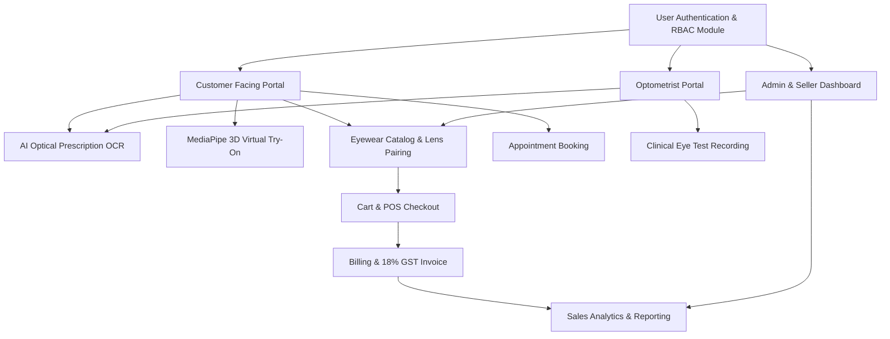
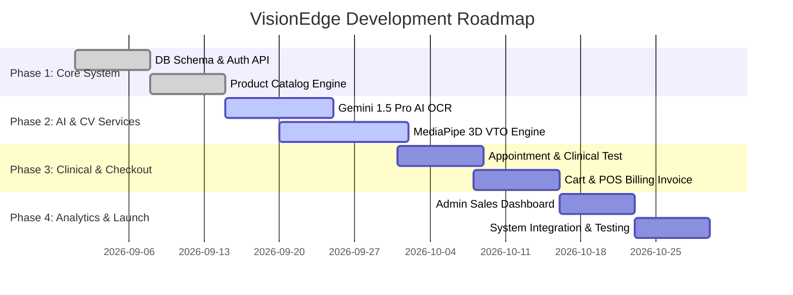

# 🕶️ VisionEdge Platform — System Module Planning Architecture

> **Executive Overview**  
> **VisionEdge** is an AI-powered, Next-Gen Smart Optical & Eyewear E-Commerce Platform. It seamlessly integrates **Gemini 1.5 Pro AI OCR** for instant optical prescription diopter extraction, **MediaPipe 468-Landmark 3D Virtual Try-On (VTO)** for real-time webcam frame fitting, **Clinical Optometry Management**, and an end-to-end **POS Billing & Analytics Engine**.

---

## 🏗️ System High-Level Module Architecture

---

## 📊 System Module & Responsibility Matrix

| Module Name | Core Responsibilities | Key Code Component |
| :--- | :--- | :--- |
| **Module 1: Identity & Authentication (RBAC)** | • User Registration & Password Hashing • Session JWT Caching & Token Security • Role Authorization State (Customer, Optometrist, Admin) | • [`auth_routes.py`](file:///c:/projects/VisionEdge/backend/routes/auth_routes.py) • [`auth_utils.py`](file:///c:/projects/VisionEdge/backend/auth_utils.py) • `User` model ([`models.py`](file:///c:/projects/VisionEdge/backend/models.py)) • [`login.html`](file:///c:/projects/VisionEdge/frontend/login.html), [`signup.html`](file:///c:/projects/VisionEdge/frontend/signup.html) |
| **Module 2: Customer CRM & Clinical Eye Test** | • Customer Profile CRUD & Health Metadata • Clinical Diopter Entry (OD/OS Sphere, Cylinder, Axis, PD) • Patient History Lookup & Examination Log | • [`customer_routes.py`](file:///c:/projects/VisionEdge/backend/routes/customer_routes.py) • [`appointment_routes.py`](file:///c:/projects/VisionEdge/backend/routes/appointment_routes.py) • `CustomerProfile`, `EyeTest`, `Appointment` models ([`models.py`](file:///c:/projects/VisionEdge/backend/models.py)) • [`profile.html`](file:///c:/projects/VisionEdge/frontend/profile.html), [`eye-test.html`](file:///c:/projects/VisionEdge/frontend/eye-test.html) |
| **Module 3: AI Vision & Virtual Try-On Suite** | • Gemini 1.5 OCR Scanner (Prescription Extraction) • Face Shape Classifier & Facial Landmark Metrics • VTO Canvas Overlay Engine (MediaPipe 468 Landmark 3D Try-On) | • [`ai_routes.py`](file:///c:/projects/VisionEdge/backend/routes/ai_routes.py) • [`virtual_tryon_routes.py`](file:///c:/projects/VisionEdge/backend/routes/virtual_tryon_routes.py) • `GeminiAI_OCRService`, `MediaPipe_VTOService` • [`face_analysis.py`](file:///c:/projects/VisionEdge/backend/utils/face_analysis.py) • [`ai-suite.html`](file:///c:/projects/VisionEdge/frontend/ai-suite.html) |
| **Module 4: Order & Inventory Management Engine** | • Listing Catalog Stream (Frames, Lenses, Specs) • Dual Inventory Matrix (Online & Retail POS Sync) • Fulfillment Pipeline (`Pending` $\rightarrow$ `Shipped` $\rightarrow$ `Delivered`) | • [`inventory_routes.py`](file:///c:/projects/VisionEdge/backend/routes/inventory_routes.py) • [`order_routes.py`](file:///c:/projects/VisionEdge/backend/routes/order_routes.py) • `Frame`, `Lens`, `Order`, `OrderItem` models ([`models.py`](file:///c:/projects/VisionEdge/backend/models.py)) • [`products.html`](file:///c:/projects/VisionEdge/frontend/products.html), [`checkout.html`](file:///c:/projects/VisionEdge/frontend/checkout.html) |
| **Module 5: Billing & GST PDF Invoicing** | • GST & Tax Calculator (18% GST: 9% CGST + 9% SGST) • Payment Log & Gateway Integration (Razorpay/Stripe) • ReportLab PDF Streamer (Invoice Generation with QR) | • [`billing_routes.py`](file:///c:/projects/VisionEdge/backend/routes/billing_routes.py) • [`pdf_generator.py`](file:///c:/projects/VisionEdge/backend/utils/pdf_generator.py) • `BillingInvoice` model ([`models.py`](file:///c:/projects/VisionEdge/backend/models.py)) • [`payment-history.html`](file:///c:/projects/VisionEdge/frontend/payment-history.html) |
| **Module 6: Analytics & Financial Reporting** | • Revenue & Sales Stream Metrics & Gross Margin Tracking • Top Brand Analytics & Eyewear Popularity • Inventory Audit Logs & Optometrist Load Analytics | • [`reports_routes.py`](file:///c:/projects/VisionEdge/backend/routes/reports_routes.py) • `AnalyticsReportService` ([`reports_routes.py`](file:///c:/projects/VisionEdge/backend/routes/reports_routes.py)) • [`dashboard.html`](file:///c:/projects/VisionEdge/frontend/dashboard.html) |

---

## 📦 Detailed Module Breakdown & Requirements

### Module 1: User Authentication & Profile Management (`AuthModule`)
- **Purpose**: Secures the platform and provides role-based access for Customers, Optometrists, and Admins.
- **Key Features**:
  - User Registration, Login, and JWT Token Authentication.
  - Password Hashing (Bcrypt / Argon2) and Session Management.
  - **Customer Profile Sub-module**: Manages customer health metadata (blood group, eye conditions, allergies, purchase history).
- **Core Entities**: `User`, `CustomerProfile`.

---

### Module 2: AI & Computer Vision Core Engine (`AIVisionEngine`)

#### 🤖 Sub-Module 2A: Gemini AI Optical Prescription OCR Service (`GeminiAI_OCRService`)
- **Purpose**: Automatically scans uploaded physical prescription images/PDFs and extracts structured optical diopter data.
- **Key Features**:
  - Image preprocessing and multimodal payload delivery to Gemini 1.5 Pro.
  - Structured extraction of:
    - **Right Eye (OD)**: Sphere, Cylinder, Axis, Add.
    - **Left Eye (OS)**: Sphere, Cylinder, Axis, Add.
    - **Pupillary Distance (PD)** value in millimeters.
  - AI confidence scoring and automated diopter range validation.
- **Core Entities**: `Prescription`, `GeminiAI_OCRService`.

#### 👓 Sub-Module 2B: MediaPipe 3D Virtual Try-On Engine (`MediaPipe_VTOService`)
- **Purpose**: Renders real-time 3D frame preview over the user's face using WebCam feed.
- **Key Features**:
  - **468 Facial Landmark Tracking** via MediaPipe Face Mesh API.
  - Real-time scale, tilt, rotation calculation based on facial position and pupil distance.
  - 3D Frame PNG / GLTF overlay rendering on HTML5 Canvas.
  - Interactive adjustment controls (brightness, opacity, frame size).
- **Core Entities**: `Frame`, `MediaPipe_VTOService`.

---

### Module 3: Clinical Examination & Appointment System (`ClinicalModule`)
- **Purpose**: Manages optometrist appointment slots and clinical eye examinations.
- **Key Features**:
  - Slot availability management for in-store or online eye tests.
  - **Clinical Eye Test Record**: Enables optometrists to record sphere, cylinder, axis, and PD values.
  - Digital signature & prescription approval workflow.
- **Core Entities**: `Appointment`, `EyeTest`, `Prescription`.

---

### Module 4: Product Catalog & Eyewear Engine (`CatalogModule`)
- **Purpose**: Manages frames, brands, categories, and custom lens configurations.
- **Key Features**:
  - Multi-tier Categorization: Men, Women, Kids, Sunglasses, Computer Glasses.
  - **Frame Specification Management**: Shape, Material, Price, Stock, 3D VTO PNG asset binding.
  - **Lens Customization Engine**: Single Vision, Bifocal, Progressive, Blue Cut, Anti-Glare, Photochromic coatings.
- **Core Entities**: `Brand`, `Category`, `Frame`, `Lens`.

---

### Module 5: E-Commerce Shopping Cart & Checkout (`CheckoutModule`)
- **Purpose**: Handles frame + lens pairing, prescription linking, and order lifecycle.
- **Key Features**:
  - Pair selected Frame with customized Lens and verified Prescription ID.
  - Cart calculation engine with promo codes and discount application.
  - Order status pipeline: `Pending` $\rightarrow$ `Processing` $\rightarrow$ `Assembling` $\rightarrow$ `Shipped` $\rightarrow$ `Delivered`.
- **Core Entities**: `Order`, `OrderItem`.

---

### Module 6: Billing, POS & Invoice Generation (`BillingModule`)
- **Purpose**: Handles financial calculation, tax compliance, and PDF invoice issuing.
- **Key Features**:
  - Automated **18% GST (CGST 9% + SGST 9%)** tax breakdown.
  - PDF Invoice generation with company branding, customer details, and itemized breakdown.
  - Integrated Payment Gateway hooks (Razorpay / Stripe ready).
- **Core Entities**: `BillingInvoice`.

---

### Module 7: Admin Sales & Analytics Dashboard (`AnalyticsModule`)
- **Purpose**: Provides high-level business intelligence and system reporting.
- **Key Features**:
  - Total sales and gross revenue metric cards.
  - Best-selling eyewear brands and top frame model breakdown.
  - Appointment load distribution and AI OCR accuracy auditing.
  - Exportable PDF / CSV reports.
- **Core Entities**: `AnalyticsReportService`.

---

## 🛠️ Technology Stack Summary

| Layer | Recommended Technology |
| :--- | :--- |
| **Frontend Framework** | HTML5, JavaScript (ES6+), Vanilla CSS (Custom Design Token System) |
| **3D & CV Engine** | Google MediaPipe Face Mesh (468 Landmarks), HTML5 Canvas Engine |
| **AI OCR Engine** | Gemini 1.5 Pro Multimodal API (`google-genai` SDK) |
| **Backend Framework** | Python (Flask / FastAPI) |
| **Database** | SQLite (Dev) / PostgreSQL (Prod) |
| **PDF Engine** | ReportLab / WeasyPrint |

---

## 🚀 Implementation Roadmap (Phased Plan)

