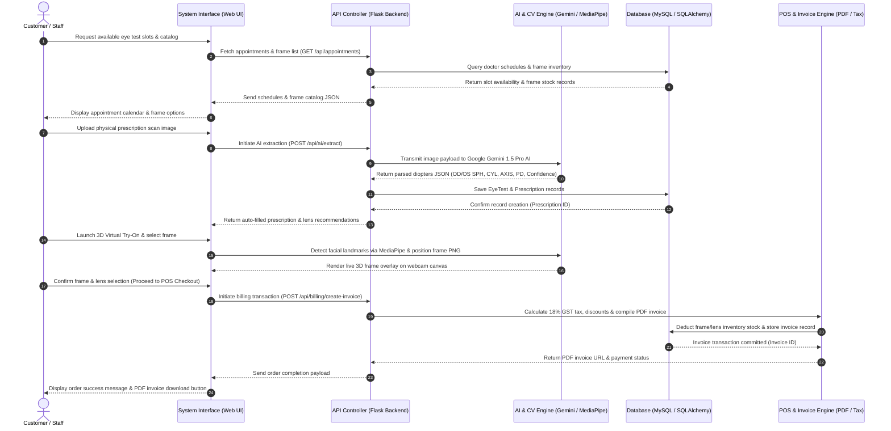

# VisionEdge System Sequence Diagram Specification
### *for*
# VisionEdge: AI-Powered Optical Store Management & Virtual Try-On System

**Version:** 1.0  
**File Created:** [visionedge_sequence_diagram.drawio](file:///c:/projects/VisionEdge/visionedge_sequence_diagram.drawio)  
**Format:** Draw.io (XML Schema) / Vector SVG / High-Res PNG Image  
**Theme:** Crisp White Background, High-Contrast Black Typography (`fontColor=#000000`)  
**Date:** August 2026  

---

## 1. Sequence Diagram Visual Image

---

## 2. Interactive Mermaid Sequence Diagram

---

## 3. Sequence Interaction Steps Matrix

| Step # | Origin | Destination | Action / API Endpoint | Payload / Data Returned |
| :---: | :--- | :--- | :--- | :--- |
| **1** | Customer / Staff | System Interface | Request Eye Test Slots & Catalog | User Click / Page Request |
| **2** | System Interface | API Controller | `GET /api/appointments/slots`, `GET /api/inventory/frames` | HTTP GET Request |
| **3** | API Controller | Database | `SELECT * FROM appointment`, `SELECT * FROM frame` | SQL Query Execution |
| **4** | Database | API Controller | Return Record Sets | SQL Result Array |
| **5** | API Controller | System Interface | HTTP 200 OK | Schedule & Frame Inventory JSON |
| **6** | System Interface | Customer / Staff | Render Calendar & Catalog View | Dynamic HTML UI Display |
| **7** | Customer / Staff | System Interface | Upload Prescription Image Scan | File Selection (JPG/PNG) |
| **8** | System Interface | API Controller | `POST /api/ai/extract` | Multipart Form Data |
| **9** | API Controller | Gemini AI Engine | Google Generative AI Multimodal Request | Image Buffer + JSON Prompt Schema |
| **10** | Gemini AI Engine | API Controller | Optical Diopters JSON | SPH, CYL, AXIS, ADD, PD, Confidence (98%) |
| **11** | API Controller | Database | `INSERT INTO eye_test`, `INSERT INTO prescription` | SQL Insert Transaction |
| **12** | Database | API Controller | Record Insertion Confirmation | Generated `prescription_id` |
| **13** | API Controller | System Interface | HTTP 201 Created | Extracted Diopters & Lens Recommendations |
| **14** | Customer / Staff | System Interface | Select Frame & Launch Virtual Try-On | Canvas Frame Selection |
| **15** | System Interface | MediaPipe Engine | `FaceMesh.send({ image: videoElement })` | Live Camera Video Frame Stream |
| **16** | MediaPipe Engine | System Interface | Facial Mesh Landmarks Grid | Real-time 2D/3D Canvas Frame Overlay |
| **17** | Customer / Staff | System Interface | Confirm Frame & Proceed to Checkout | Form Submit |
| **18** | System Interface | API Controller | `POST /api/billing/create-invoice` | Order Lines (Frame ID, Lens ID, Customer ID) |
| **19** | API Controller | POS Invoice Engine | Calculate Tax & Generate Invoice PDF | Subtotal, Discount, 18% GST, FPDF Compilation |
| **20** | POS Invoice Engine | Database | `UPDATE frame SET stock = stock - 1`, `INSERT INTO billing` | SQL Stock Reduction & Billing Commit |
| **21** | Database | POS Invoice Engine | Transaction Committed | Database Commit Acknowledgment |
| **22** | POS Invoice Engine | API Controller | Generated Invoice PDF File | File Path `invoice_INV_2026_001.pdf` |
| **23** | API Controller | System Interface | HTTP 200 OK | Order Status & PDF Download URL |
| **24** | Customer / Staff | System Interface | Display Success Screen & Printable Receipt | Order Confirmation Screen |

---

## 4. Available File Downloads

* 🖼️ **PNG Image**: [visionedge_sequence_diagram_exact.png](file:///c:/projects/VisionEdge/diagrams/png/visionedge_sequence_diagram_exact.png)
* 📐 **Vector SVG**: [visionedge_sequence_diagram.svg](file:///c:/projects/VisionEdge/visionedge_sequence_diagram.svg)
* 🔷 **Draw.io File**: [visionedge_sequence_diagram.drawio](file:///c:/projects/VisionEdge/visionedge_sequence_diagram.drawio)
* 🔴 **PDF Report**: [VisionEdge_Sequence_Diagram_Doc.pdf](file:///c:/projects/VisionEdge/VisionEdge_Sequence_Diagram_Doc.pdf)

---
*End of VisionEdge Sequence Diagram Specification.*
